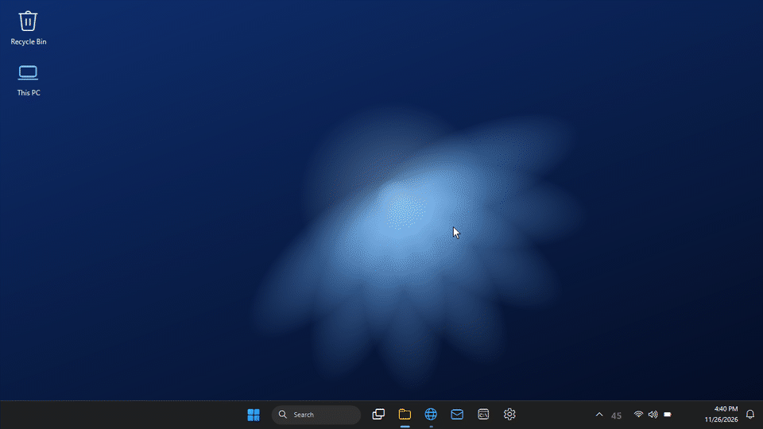
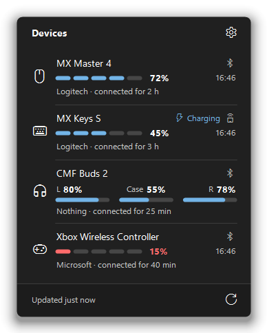
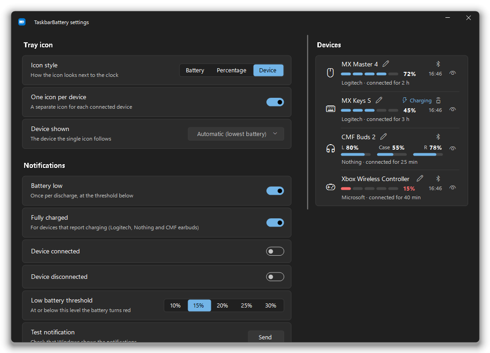
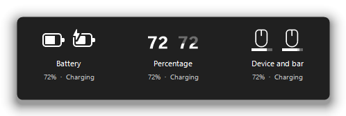
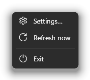

# TaskbarBattery

Shows the battery level of your wireless mouse, keyboard, headset and earbuds in the Windows 11 taskbar (system tray),
whatever the brand: Bluetooth devices, Logitech devices on Bluetooth or on a Bolt, Unifying or LIGHTSPEED receiver
(MX Master, MX Keys, G series), Nothing / CMF earbuds and AirPods with left, right and case. Charging state, low
battery notifications, no vendor software (no Logi Options+, G HUB or Nothing X) needed.

[Italiano](README.it.md)

<p align="center">
  
</p>

<table>
  <tr>
    <td align="center" valign="top" width="25%">
      <a href="docs/img/panel-en.png"></a><br>
      <b>Panel</b><br>
      <sub>Every connected device, with level, charging state, connection and time connected.</sub>
    </td>
    <td align="center" valign="top" width="25%">
      <a href="docs/img/settings-en.png"></a><br>
      <b>Settings</b><br>
      <sub>Icon, notifications and general options beside the devices, with rename and show/hide.</sub>
    </td>
    <td align="center" valign="top" width="25%">
      <a href="docs/img/icons-en.png"></a><br>
      <b>Tray icon</b><br>
      <sub>Three styles; while charging the battery shows a bolt, the digits fill up and the bar animates.</sub>
    </td>
    <td align="center" valign="top" width="25%">
      <a href="docs/img/menu-en.png"></a><br>
      <b>Menu</b><br>
      <sub>Right click: settings, refresh, exit.</sub>
    </td>
  </tr>
</table>

<sub>Illustrative images: the desktop is a mock-up and the devices and their levels are example values.</sub>

## How it works

- **Any Bluetooth device.** Windows already reads the battery of many Bluetooth devices (the standard GATT Battery
  Service) and keeps the last value as a device property. TaskbarBattery reads that property, so mice, keyboards,
  controllers and headsets that report their battery over Bluetooth work without vendor software.
- **Logitech devices, more detail.** Over Logitech's HID++ protocol the app also reads the charging state and a fresher
  level. It keeps the device's HID++ channel open and waits for the device's own battery notifications, so plugging or
  unplugging the cable shows up immediately, with no polling.
- **Logitech receivers, cables and dongles.** Devices behind a Unifying, Bolt or LIGHTSPEED receiver (up to six per
  receiver), devices on a USB cable and headsets on their own dongle have no battery level in Windows: the app reads
  them over HID++ through the receiver, or over the newer headsets' own protocol. Receivers report devices connecting
  and disconnecting at once; devices that only give a voltage get a percentage from a Li-ion discharge curve.
- **Nothing and CMF earbuds.** Windows gets no battery level from them, so the app reads it over the earbuds' own
  control channel (the Bluetooth service the Nothing X app uses): left bud, right bud and case, each with its
  charging state, on a single card. The channel stays open and the earbuds report changes themselves. Any model that
  exposes that service is recognised, whatever its name.
- **AirPods and Beats.** Windows shows at most one level for them. The app listens to the Bluetooth messages they
  broadcast while out of the case or with the lid open, the same ones an iPhone uses for its pop-up: left, right and
  case, in steps of 10%, with charging state, on the same kind of card. Nothing is sent to the earbuds, and with the
  case closed the card keeps the last reading.
- Only connected devices are shown.

## The tray icon

One icon, for the device you pick or, automatically, the connected device with the lowest battery. Three styles,
from the right-click menu:

- **Battery**: the Windows battery outline, filled to the level; the battery with a bolt while charging.
- **Percentage**: the number; while charging, the digits fill up from the bottom, step by step.
- **Device and bar**: the device glyph with a level bar; while charging, the bar animates towards full.

With **One icon per device**, every connected device gets its own icon. The level turns red at the low-battery
threshold (20% by default). Click the icon for the panel with every connected device: a five-segment meter, the
percentage, the charging state (Logitech), the maker and how long it has been connected. Earbuds get three columns,
left, case and right, each with its own bar; a part that does not report stays visible, dimmed, with "--%". The icon
follows the emptier bud.

## Settings

Open them from the gear at the top right of the panel, or with **Settings…** in the right-click menu (which also has
**Refresh now** and **Exit**). Changes apply at once.

- **Tray icon**: icon style, one icon per device, which device the single icon follows.
- **Notifications**: low battery (once per discharge), fully charged (Logitech, earbuds), device connected or disconnected,
  each on or off, with a low-battery threshold from 10% to 30% and a test notification.
- **Devices**: rename a device or hide it from the icon, the panel and the notifications.
- **General**: start with Windows (per-user startup list) and the diagnostic log,
  `%LOCALAPPDATA%\TaskbarBattery\log.txt`, which records changes and errors only.
- **About**: version, licence, links to the source code and to report a problem.

## Supported devices

✅ supported and tested · 🟡 implemented, not tested yet · ⚪ unknown · ❌ not supported

**Logitech**

| Device or connection | Status | Notes |
|---|---|---|
| MX Master 4 (Bluetooth) | ✅ | Level, charging state and live updates over HID++. |
| Other Bluetooth LE devices with HID++ (MX Keys, MX Anywhere, Lift, Ergo, Pebble…) | 🟡 | Same channel as the MX Master 4. |
| Devices on a Bolt receiver (MX Master 4 tested) | ✅ | All six slots are checked; connections and disconnections show at once. |
| Devices on a Unifying receiver | 🟡 | HID++ 2.0 devices only. |
| Mice and keyboards on a LIGHTSPEED receiver (G series) | 🟡 | Many report a voltage: the percentage is an estimate. |
| Devices on a USB cable | 🟡 | Merged with the same device on a receiver when its wireless id is known. |
| Headsets on their own dongle (G533, G733, G PRO X…) | 🟡 | Voltage based, estimated percentage. |
| Newer headsets (PRO X 2 LIGHTSPEED and similar) | 🟡 | Their own protocol, not HID++. |
| Older Unifying devices with HID++ 1.0 only | ❌ | They use a different battery register. |
| Older Bluetooth Classic devices (for example K380) | ⚪ | Windows rarely gets their battery; HID++ not verified. |

**Nothing and CMF**

| Device | Status | Notes |
|---|---|---|
| CMF Buds 2 | ✅ | Left, right and case, with charging state. |
| Other earbuds that use the Nothing X app (CMF Buds, Buds Pro, Buds Pro 2, Nothing Ear, Ear (a), Ear (2), Ear (stick)) | 🟡 | Found by their control service; same battery format. |
| Nothing Ear (1) | 🟡 | Slightly different message header, which the parser accepts. |
| Over-ear headphones (CMF Headphone Pro, Nothing Headphone (1)) | ⚪ | Probably the same channel, but the battery may use other ids. |
| CMF Watch | ❌ | Different protocol. |

**Apple and Beats**

| Device | Status | Notes |
|---|---|---|
| AirPods (2nd to 4th generation), AirPods Pro, Pro 2 and Pro 3 | 🟡 | Left, right and case from their Bluetooth messages, in steps of 10%. Not yet tested on a real pair. |
| AirPods Max | 🟡 | One level, same messages. |
| Beats earbuds and headphones (Studio Buds, Fit Pro, Solo, Studio…) | ⚪ | They send the same kind of messages; not verified. |
| Two pairs of the same model connected at once | ❌ | The messages do not say which pair sent them, so neither gets a reading. |

**Other brands**

| Device | Status | Notes |
|---|---|---|
| Bluetooth devices with the standard battery service (Xbox Wireless Controller tested) | ✅ | Level from Windows; no charging state. |
| Bluetooth devices whose battery Windows does not show | ❌ | Would need the maker's own protocol. |

`TaskbarBattery.exe --probe` shows what the app sees for each device: it is the quickest way to check a 🟡 or ⚪ one.

## Requirements

Windows 10 or 11. .NET Framework 4.x is preinstalled.

## Build

```
build.bat
```

It uses the C# compiler that ships with Windows; no SDK or IDE is needed.

## Troubleshooting

```
TaskbarBattery.exe --probe | Out-String
```

prints every device that reports a battery level, the Logitech HID collections, what HID++ answers, what the
connected Nothing / CMF earbuds report, the AirPods and Beats messages heard in 10 seconds, and the Logitech
devices found on receivers, cables and dongles.
Settings are stored in `%APPDATA%\TaskbarBattery\settings.txt`.

## License

MIT
